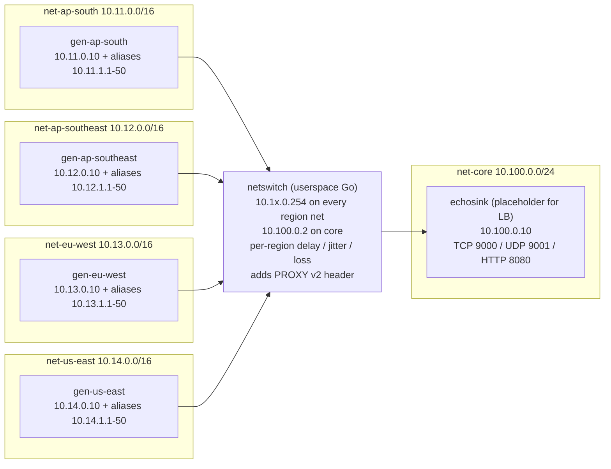
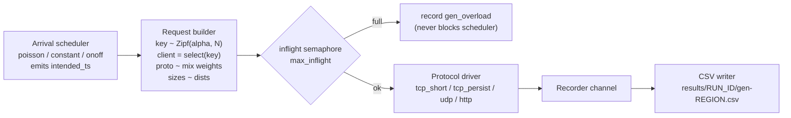

# Stream B — Multi-Region Traffic Generator + Impairment Switch (Full Reference Design)

> [!NOTE]
> **Status: long-term reference design.** The current milestone builds a simpler subset, described in [`milestone_plan.md`](milestone_plan.md) and explained in [`milestone_explainer.md`](milestone_explainer.md). Decisions made since this document was written:
> - **Client selection: `by_key`** (Open Question Q1 resolved). Each key always maps to the same client IP, so hot keys show up as hot source IPs for the L4 load balancer.
> - **Topology: 3 containers** (`trafficgen`, `switch`, `server`) instead of one generator container per region. Regions are /24 blocks of alias IPs inside one client network (`10.10.1.0/24` = ap-south, `10.10.2.0/24` = ap-southeast, …). This replaces the per-region networks in §4.1 and §7.12.
> - **Source-IP carrier for the milestone:** PROXY protocol **v1** (one text line), not v2. v2 is kept here as a later upgrade.

**Project:** CS G525 Track C / C5 — L4 Load Balancer (Team 9)
**Owner:** Stream B — Workload & Stress Harness (Nahush Kashyap M A)
**Scope of this milestone:** set up the emulation environment and build (1) a Go traffic generator that sends Zipf-keyed TCP / UDP / HTTP traffic from many real source IPs in several "regions", and (2) a Go userspace "switch" that adds per-region latency, jitter and packet loss before handing traffic on. A temporary **echo-sink** stands in for the load balancer and confirms what arrives. The real LB (Stream A) will later replace the sink and need no changes on the generator side.

> This document is meant to be handed to AI coding agents. Every task in [§9 Agent Task Breakdown](#9-agent-task-breakdown) is self-contained and lists its files, interfaces and acceptance criteria.

---

## 1. Goal Description

The proposal (§4, §6, §7) needs a workload harness that can:

| Requirement (source) | How this milestone meets it |
|---|---|
| Destination keys drawn from a **Zipf** distribution with configurable α ∈ {0.8, 1.0, 1.2} (§4.2, §7) | Our own CDF-based Zipf sampler (Go's `rand.Zipf` only supports s > 1, so it can't do α = 0.8 or 1.0) |
| **Configurable target rate** (§4.2) | Open-loop Poisson or constant-rate arrivals; latency is measured from the *intended* send time, so a slow system can't hide its delays |
| **Tail latency p50/p95/p99** from the client side (§6) | Per-request CSV records with intended / start / first-byte / end timestamps |
| **Resets / failures** visible to the client (§6) | Each request gets an outcome: `ok`, `timeout`, `reset`, `refused`, `gen_overload` |
| Containers on one workstation (§4, §5) | Docker Compose: 1 switch, 4 region generators, 1 sink |
| Go only in the data path (§5) | Everything is Go. Python is only for offline analysis (Stream C) |

**Additions you asked for** (beyond the proposal):
- **Source IP + location** for every request: each region has its own subnet, and each generator adds N IP aliases (default 50), so downstream components see real, distinct client IPs.
- **Multiple protocols:** short-lived TCP, persistent TCP, UDP request/response and HTTP/1.1, behind a pluggable `Protocol` interface so more can be added later.
- **Region impairment:** a userspace switch adds one-way delay + jitter in **both directions**, plus probabilistic loss, with settings per region and changeable while running.

---

## 2. User Review Required

> [!IMPORTANT]
> **How the real source IP survives the userspace switch: PROXY protocol v2.**
> A userspace proxy ends the client's TCP connection and opens a new one, so the next hop would see the *switch's* IP. To keep the client IP and region, the switch sends a **PROXY protocol v2** header (the standard used by HAProxy, AWS NLB and Envoy) at the start of each upstream TCP connection and before each UDP datagram. The region ID travels in a custom TLV (`0xE0`).
> **Effect on Stream A:** the load balancer must parse PROXY v2 (about 80 lines of Go, and we will provide `internal/proxyproto` as a shared package). There is also a config option `proxy_protocol: none` that turns this off.
> Alternative (not planned): transparent proxying with `IP_TRANSPARENT`/TPROXY, which needs `NET_ADMIN`, policy routing and return-path routing through the switch. That is much more fragile on Docker Desktop for macOS.

> [!IMPORTANT]
> **TCP loss in userspace is *emulated*, not real packet loss.** The switch never sees TCP segments, because the kernel has already reassembled the byte stream. To make the probabilistic drop function mean something for TCP, the switch splits the stream into virtual MSS-sized segments (1448 B). Each segment is "lost" with probability *p*, and a loss is modelled the way TCP experiences it:
> - **Lost data segment:** that segment and everything behind it is held for one **RTO** (min 200 ms, as in Linux), doubling on consecutive losses (head-of-line blocking).
> - **Lost SYN:** the first data is held 1 s, then 2 s, … (Linux's initial SYN RTO).
> - **Too many retries** (default 6): the switch sends a **RST** to the client, which the generator records as a `reset`.
>
> **UDP loss is real:** datagrams really are dropped.

> [!WARNING]
> **Connect latency vs time-to-first-byte (TTFB).** The client's TCP handshake finishes at the switch, so connect time measured by the client only covers the local hop. To keep latency realistic, the switch adds a **handshake penalty** (1 extra RTT) before forwarding the first data on a new connection. **TTFB is therefore the main latency metric** for TCP and HTTP, which matches proposal §6 ("connection-establishment (or first-byte) latency"). Stream C should be told about this.

---

## 3. Open Questions

> [!IMPORTANT]
> **Q1 (RESOLVED → `by_key`). How should Zipf "keys" show up to an L4 load balancer?** An L4 LB hashes on the 5-tuple and normally can't see payload keys. The plan supports three modes in `clients.selection`:
> - `by_key` **(default)**: the key decides the client alias (`alias = hash(key) % N`), so hot keys become hot source IPs, which is the skew an L4 hash actually sees.
> - `uniform` / `zipf`: the client IP is chosen on its own; the key appears only in the frame header (useful if Stream A hashes on the first payload bytes).
>
> Please confirm with Adithya (Stream A) which mode the hashing policies will use.

> [!NOTE]
> **Q2. Default regions and impairments.** These are placeholders based on typical India-to-region RTTs, with the "datacenter" in Mumbai (ap-south). All values are **one-way** (RTT ≈ 2× base):
>
> | Region | ID | Subnet | One-way delay | Jitter (σ) | Loss model | Loss p |
> |---|---|---|---|---|---|---|
> | ap-south (local) | 1 | 10.11.0.0/16 | 2 ms | 0.5 ms | bernoulli | 0.0001 |
> | ap-southeast | 2 | 10.12.0.0/16 | 30 ms | 3 ms | bernoulli | 0.002 |
> | eu-west | 3 | 10.13.0.0/16 | 65 ms | 8 ms | gilbert-elliott | ≈0.005 avg |
> | us-east | 4 | 10.14.0.0/16 | 110 ms | 15 ms | gilbert-elliott | ≈0.01 avg |
>
> Change these freely. They live only in `configs/topology.yaml`.

> [!NOTE]
> **Q3. Default rate.** The default is 250 req/s per region (1000 req/s total). The proposal's risk table says to benchmark the real ceiling in Week 1. Task T11 includes a rate-ceiling benchmark script for this.

---

## 4. Architecture

### 4.1 Topology



- Every region network is a separate Docker bridge with `internal: true`. Docker isolates bridges from each other, so **a generator can reach the sink only through the switch**.
- The switch decides a connection's region from its **source IP** (longest-prefix match over region subnets). Connections from unknown subnets are rejected and counted.
- Later milestones: `echosink` is replaced by the LB (Stream A) on `net-core`, and the backend pool sits behind the LB on a separate `net-backend` network.

### 4.2 Request path (new TCP connection)

```mermaid
sequenceDiagram
  participant G as trafficgen (alias 10.13.1.7)
  participant S as netswitch
  participant K as echosink / LB
  G->>S: TCP connect (completes locally)
  G->>S: request frame (key, req_id, ts)
  Note over S: region = lookup(10.13.1.7) → eu-west<br/>SYN-loss roll; handshake penalty = 1 RTT
  Note over S: upstream delay line: one-way delay + jitter, per-segment loss → RTO hold
  S->>K: PROXY v2 hdr (src=10.13.1.7, TLV region=3) + frame
  K-->>S: response frame (server_id, echo req_id)
  Note over S: downstream delay line: one-way delay + jitter + loss
  S-->>G: response frame
  Note over G: record intended / start / connect / first_byte / end, outcome
```

### 4.3 Generator pipeline



---

## 5. Repository Layout

```
AcnProject/
├── go.mod                         # module acnlb ; go 1.22 ; only dep: gopkg.in/yaml.v3
├── Makefile
├── README.md
├── cmd/
│   ├── trafficgen/main.go         # region traffic generator
│   ├── netswitch/main.go          # userspace impairment switch
│   └── echosink/main.go           # temporary upstream (stand-in for LB)
├── internal/
│   ├── config/                    # YAML structs, defaults, validation (topology + workload)
│   ├── wire/                      # binary request/response frame codec (TCP + UDP)
│   ├── proxyproto/                # PROXY protocol v2 encode/decode (+ region TLV)
│   ├── zipf/                      # CDF Zipf sampler, any alpha > 0
│   ├── arrival/                   # poisson / constant / on-off schedulers
│   ├── dist/                      # size distributions: fixed / uniform / lognormal
│   ├── region/                    # CIDR → Region table
│   ├── impair/                    # delay+jitter sampler, Bernoulli & Gilbert-Elliott loss
│   ├── delayline/                 # order-preserving delayed writer
│   ├── relay/                     # TCP relay + UDP session relay used by netswitch
│   ├── gen/                       # protocol drivers + client pool + run loop
│   ├── netutil/                   # IP alias setup (exec `ip addr add`), iface lookup
│   ├── record/                    # per-request CSV recorder + end-of-run summary
│   └── stats/                     # atomic counters + JSON /stats endpoint helper
├── configs/
│   ├── topology.yaml              # regions, subnets, impairments, switch forwards
│   └── workload.yaml              # rate, keys, mix, sizes, timeouts
├── deploy/
│   ├── Dockerfile                 # one multi-stage image containing all 3 binaries
│   └── docker-compose.yml
├── scripts/
│   ├── smoke.sh                   # up → run 60 s → verify → down
│   ├── verify.py                  # offline checks on results CSVs (analysis only)
│   └── ratebench.sh               # find sustainable rate ceiling
└── results/                       # gitignored; results/<RUN_ID>/*.csv
```

---

## 6. Configuration

### 6.1 `configs/topology.yaml` (used by switch, generators and sink)

```yaml
proxy_protocol: v2            # v2 | none
switch:
  admin_listen: ":9100"       # GET /healthz /stats /regions ; PATCH /regions/{name}
  forwards:                   # protocol-agnostic L4 forwards
    - { name: tcp,  proto: tcp, listen: ":9000", upstream: "10.100.0.10:9000" }
    - { name: http, proto: tcp, listen: ":8080", upstream: "10.100.0.10:8080" }
    - { name: udp,  proto: udp, listen: ":9001", upstream: "10.100.0.10:9001" }
  tcp:
    virtual_mss: 1448
    min_rto: 200ms
    syn_rto: 1s
    max_retries: 6            # exceeded → RST to client
    emulate_handshake: true   # +1 RTT before first upstream byte of a new conn
  udp:
    session_idle_timeout: 30s

regions:
  - name: ap-south
    id: 1
    subnet: 10.11.0.0/16
    switch_ip: 10.11.0.254
    alias_cidr: 10.11.1.0/24
    clients: 50
    impairment:
      delay:  { base: 2ms, jitter: 0.5ms, dist: normal }   # one-way, applied each direction
      loss:   { model: bernoulli, p: 0.0001 }
      bandwidth_kbps: 0                                    # 0 = unlimited (stretch)
  - name: eu-west
    id: 3
    subnet: 10.13.0.0/16
    switch_ip: 10.13.0.254
    alias_cidr: 10.13.1.0/24
    clients: 50
    impairment:
      delay: { base: 65ms, jitter: 8ms, dist: normal }
      loss:
        model: gilbert-elliott
        p_good_to_bad: 0.002
        p_bad_to_good: 0.25
        loss_good: 0.001
        loss_bad: 0.5
  # ... ap-southeast (id 2), us-east (id 4) as in §3 Q2
```

### 6.2 `configs/workload.yaml` (used by generators)

```yaml
run:
  duration: 300s              # proposal §7: 5-minute runs
  warmup: 10s                 # records flagged warmup=1, excluded by analysis
  drain: 5s                   # wait for in-flight after duration
  seed: 42                    # per-region RNG seed = seed ^ (region.id * 0x9E3779B97F4A7C15)
  output_dir: /results

arrival:
  process: poisson            # poisson | constant | onoff
  rate: 250                   # req/s per region (override per region below)
  onoff: { on: 2s, off: 1s }
  per_region_rate: { us-east: 150 }

keys:
  distribution: zipf          # zipf | uniform
  n: 10000
  alpha: 1.0                  # sweep: 0.8 / 1.0 / 1.2
  shuffle: true               # random rank→key permutation (fixed by seed)

clients:
  selection: by_key           # by_key | uniform | zipf  (see Open Question Q1)
  zipf_alpha: 1.0             # only for selection: zipf

mix:                          # normalized weights
  tcp_short: 0.4
  tcp_persist: 0.3
  udp: 0.2
  http: 0.1

sizes:
  request:  { dist: fixed, value: 128 }
  response: { dist: lognormal, median: 512, sigma: 1.0, max: 65536 }
  udp_max_payload: 1200       # clamp for UDP (both directions)

tcp_persist:
  conns_per_client: 2
  max_requests_per_conn: 100  # then close + reopen (client-side churn)

timeouts:
  connect: 2s
  request: 5s                 # UDP: no reply within this → outcome=timeout
concurrency:
  max_inflight: 4000
```

Generators get their region from the CLI: `trafficgen -topology /configs/topology.yaml -workload /configs/workload.yaml -region eu-west -run-id $RUN_ID`. Environment variables `TG_RATE`, `TG_ALPHA` and `TG_DURATION` override the matching YAML values, so sweep scripts don't need to edit files.

---

## 7. Proposed Changes (component by component)

### 7.1 Project scaffold

#### [NEW] go.mod
`module acnlb`, `go 1.22` (works with the team's 1.22+ requirement; builds on the local 1.27.1). The only dependency is `gopkg.in/yaml.v3`. Use `math/rand/v2` (PCG source) for seeded, reproducible RNG, and `log/slog` for structured logs.

#### [NEW] Makefile
Targets: `build`, `test` (`go test ./...`), `race` (`go test -race ./...`), `vet`, `docker-build`, `up`, `down`, `smoke`, `ratebench`, `clean`.

---

### 7.2 `internal/wire`: application frame codec

Fixed 48-byte big-endian header, used by both TCP (stream, length-delimited by `payload_len`) and UDP (one frame per datagram).

```
off  size  field
0    4     magic       0x4C424731 ("LBG1")
4    1     version     1
5    1     type        1=REQ 2=RESP
6    1     proto       1=tcp_short 2=tcp_persist 3=udp 4=http(unused in frames)
7    1     flags       bit0=warmup
8    8     req_id      unique per generator (region_id<<56 | counter)
16   8     key         Zipf key id
24   8     send_ts     unix nanoseconds at generator (actual send)
32   4     client_ip   IPv4 the generator bound to
36   2     region_id
38   2     reserved
40   4     payload_len bytes following header
44   4     resp_len    REQ: bytes the server should return ; RESP: 0
48   N     payload     REQ: filler ; RESP: server_id[16] + resp_len filler
```

```go
type Header struct {
    Type, Proto, Flags uint8
    ReqID, Key         uint64
    SendTS             int64
    ClientIP           netip.Addr
    RegionID           uint16
    PayloadLen, RespLen uint32
}
func (h *Header) MarshalTo(b []byte) error      // len(b) >= HeaderLen
func ParseHeader(b []byte) (Header, error)      // validates magic/version
func WriteFrame(w io.Writer, h Header, payload []byte) error
func ReadFrame(r io.Reader, maxPayload uint32) (Header, []byte, error)
```

HTTP does not use frames: `GET /obj/{key}?size={resp_len}` with headers `X-Req-Id`, `X-Send-Ts`, `X-Region`, `X-Client-IP`; the response carries `X-Server-Id`.

---

### 7.3 `internal/proxyproto`: PROXY protocol v2

```go
var Signature = [12]byte{0x0D,0x0A,0x0D,0x0A,0x00,0x0D,0x0A,0x51,0x55,0x49,0x54,0x0A}
const TLVRegion = 0xE0  // PP2_TYPE_MIN_CUSTOM; value = uint16 region id

type Header struct {
    Transport   byte           // 0x11 TCP/IPv4, 0x12 UDP/IPv4
    Src, Dst    netip.AddrPort
    RegionID    uint16         // 0 = absent
}
func (h Header) Marshal() []byte                     // ver_cmd=0x21
func Read(r *bufio.Reader) (Header, bool, error)     // bool=false if no signature (passthrough)
func Parse(b []byte) (Header, int, error)            // for UDP datagrams; returns consumed len
```
Test against byte vectors from the HAProxy PROXY protocol spec.

---

### 7.4 `internal/zipf`: sampler that supports any α > 0

```go
// Zipf samples ranks 1..N with P(k) ∝ 1/k^alpha, mapped through a fixed permutation.
type Zipf struct {
    cdf  []float64 // cdf[i] = P(rank <= i+1)
    perm []uint64  // rank-1 → key id
}
func New(n int, alpha float64, shuffle bool, seed uint64) (*Zipf, error) {
    cdf := make([]float64, n)
    var sum float64
    for i := 1; i <= n; i++ {
        sum += math.Pow(float64(i), -alpha)
        cdf[i-1] = sum
    }
    for i := range cdf { cdf[i] /= sum }
    cdf[n-1] = 1.0
    // perm = identity or rand.New(rand.NewPCG(seed, ^seed)).Perm(n)
    ...
}
func (z *Zipf) Sample(r *rand.Rand) uint64 {
    i, _ := slices.BinarySearch(z.cdf, r.Float64())
    return z.perm[min(i, len(z.perm)-1)]
}
func (z *Zipf) Prob(rank int) float64 // for tests / verify
```
Each sample is O(log N), and N = 10⁶ uses 8 MB. Rank-1 share at N = 10⁴: α = 0.8 ≈ 3.9%, α = 1.0 ≈ 10.2%, α = 1.2 ≈ 21%. The test computes these exactly with `Prob`.

---

### 7.5 `internal/arrival`: open-loop schedulers

```go
type Process interface { Next(r *rand.Rand) time.Duration } // gap to next arrival
type Poisson  struct{ Rate float64 }          // gap = ExpFloat64()/Rate
type Constant struct{ Rate float64 }
type OnOff    struct{ Inner Process; On, Off time.Duration } // silent during Off

// Run emits intended timestamps on absolute schedule t0 + Σgaps (no drift).
func Run(ctx context.Context, p Process, r *rand.Rand, out chan<- time.Time)
```
The scheduler sleeps until each absolute target time. If it falls behind, it catches up by emitting immediately rather than skipping, so the requested rate is met. The intended time is recorded so queueing delay shows up in latency.

---

### 7.6 `internal/region` + `internal/impair`

```go
type Region struct {
    Name string; ID uint16; Subnet netip.Prefix
    Model atomic.Pointer[impair.Model] // swapped live by admin API
}
type Table struct{ regions []*Region }
func (t *Table) Lookup(ip netip.Addr) (*Region, bool) // longest prefix match

// impair
type Model struct {
    Base, Jitter time.Duration; Dist string   // "normal" | "uniform" | "none"
    Loss LossSpec
}
func (m *Model) Delay(r *rand.Rand) time.Duration // clamped >= 0
type LossState interface{ Lost(r *rand.Rand) bool } // one per flow per direction
func (m *Model) NewLossState() LossState // Bernoulli or Gilbert-Elliott (stateful)
```

---

### 7.7 `internal/delayline`: delivery that keeps byte order

```go
// Line delays writes to w while preserving FIFO order (jitter never reorders a TCP stream).
type Line struct {
    w    io.Writer
    ch   chan item
    last time.Time
    err  atomic.Value
}
type item struct{ b []byte; at time.Time; rst bool }

func (l *Line) Push(b []byte, delay time.Duration) {
    at := time.Now().Add(delay)
    if at.Before(l.last) { at = l.last }   // monotonic release times
    l.last = at
    l.ch <- item{b: b, at: at}
}
func (l *Line) run() {
    for it := range l.ch {
        if d := time.Until(it.at); d > 0 { time.Sleep(d) }
        if _, err := l.w.Write(it.b); err != nil { l.err.Store(err); return }
    }
}
```
UDP uses a version without ordering (`at` isn't clamped), so jitter can reorder datagrams as it does on real networks. Sleep resolution on the Linux VM is under 1 ms, which is fine for delays measured in milliseconds.

---

### 7.8 `internal/relay` + `cmd/netswitch`

**TCP relay** (one goroutine pair per connection):
1. `Accept` → `region := table.Lookup(src)`. If the source is unknown, close and count `unknown_src`.
2. **SYN-loss emulation:** for each SYN "attempt" where `loss.Lost()` is true, add `syn_rto · 2^attempt`. If attempts exceed `max_retries`, `SetLinger(0)` + `Close()` (sends RST) and count `syn_reset`.
3. Dial upstream (`forward.upstream`) and write the PROXY v2 header (TCP4, src = client, dst = switch region IP, TLV region).
4. **Upstream pipe:** read chunks of up to 32 KiB, split them into `virtual_mss` segments, and give each a delay of `Delay()` (+ handshake penalty `2·base` on the first segment of the connection). If `Lost()` is true, add `rto·2^consecutive` (consecutive losses are reset after a success, `rto = max(min_rto, 2·base + 4·jitter)`). If consecutive losses exceed `max_retries`, RST both sides. Then `Push` to the delay line.
5. **Downstream pipe:** the same logic in reverse, without the handshake penalty.
6. Half-close: when one side sends EOF, call `CloseWrite` on the other side after the delay line drains.

**UDP relay** (session table keyed by client `AddrPort`):
1. On a datagram from the client: look up or create the session (a `net.DialUDP` socket to upstream plus a reader goroutine), then roll `Lost()`. If lost, drop and count it; otherwise schedule `Write(proxyHdr ‖ datagram)` after `Delay()`.
2. Upstream reader: on each response, roll `Lost()`. If not lost, schedule `listener.WriteToUDP(resp, clientAddr)` after `Delay()`.
3. Sessions idle longer than `session_idle_timeout` are removed.

**Admin API** (`:9100`): `GET /healthz`, `GET /stats` (JSON per region: `conns_accepted, conns_active, syn_lost, syn_reset, seg_lost, retx_resets, bytes_up, bytes_down, udp_in, udp_out, udp_dropped_up, udp_dropped_down, delay_ms_hist`), `GET /regions`, `PATCH /regions/{name}` with a JSON `impairment` body, applied immediately via `atomic.Pointer`. Stream B can use this later for "region degradation" stress events.

The switch also writes a 1 s stats snapshot to `results/<RUN_ID>/switch-stats.jsonl`.

---

### 7.9 `cmd/echosink`: temporary upstream

- Listens on TCP `:9000` (frames), TCP `:8080` (HTTP) and UDP `:9001` (frames).
- Detects and strips the PROXY v2 header automatically, recording the **observed client IP and region**.
- Replies with a `RESP` frame: echoed header fields, `server_id` (env `SERVER_ID`, default hostname), and `resp_len` filler bytes. HTTP replies the same way with headers.
- Writes `results/<RUN_ID>/sink.csv`: `recv_ns, proto, req_id, key, pp_src_ip, pp_src_port, pp_region, frame_client_ip, frame_region, bytes`.
- This becomes the starting point for the real **backend pool** (Stream B, later milestone), which will add an active-connection count.

---

### 7.10 `internal/gen` + `cmd/trafficgen`

```go
type Request struct {
    ReqID, Key   uint64
    Proto        ProtoKind
    Client       netip.Addr     // alias to bind
    ReqBytes, RespBytes int
    Intended     time.Time
    Warmup       bool
}
type Result struct {
    Start, Connected, FirstByte, End time.Time
    ClientPort   uint16
    Outcome      Outcome        // ok|timeout|reset|refused|proto_error|gen_overload
    Err          string
    ServerID     string
    ConnReused   bool
    RespBytes    int
}
// Protocol is the extension point for new traffic types.
type Protocol interface {
    Name() string
    Do(ctx context.Context, req Request) Result
    Close() error
}
```

| Driver | Behaviour |
|---|---|
| `tcp_short` | `net.Dialer{LocalAddr: client:0, Timeout: connect}` → write frame → read response → close. One connection per request (creates connection churn) |
| `tcp_persist` | Pool per client alias (`conns_per_client`), with idle connections kept in a channel. Each connection handles one request at a time and is recycled after `max_requests_per_conn`. A broken connection is recorded as `reset` and replaced |
| `udp` | One `net.ListenUDP(client:0)` socket per client. Responses are matched to requests by `req_id` (`map[uint64]chan`), and no reply within `timeouts.request` counts as `timeout` (= loss) |
| `http` | `http.Client` with a custom `DialContext` that binds the client alias. Keep-alives are configurable, and TTFB comes from `httptrace.GotFirstResponseByte` |

**Run loop:** arrival scheduler → builder (key, client, proto, sizes) → non-blocking semaphore acquire (if full, record `gen_overload`) → `go driver.Do()` → recorder. On SIGTERM/SIGINT: stop scheduling, wait `drain`, flush and print a summary (count, outcome breakdown, p50/p95/p99 TTFB per protocol).

**Alias setup** (`internal/netutil`): at startup, find the interface that holds an address in `region.subnet`, then for i in 1..clients run `ip addr add <alias_cidr base + i>/<subnet bits> dev <iface>` (ignoring `File exists`). Needs `cap_add: NET_ADMIN`.

---

### 7.11 `internal/record`: per-request CSV (the contract with Stream C)

`results/<RUN_ID>/gen-<region>.csv`, one row per request:

```
run_id,region,region_id,proto,req_id,key,client_ip,client_port,
intended_ns,start_ns,connect_ns,first_byte_ns,end_ns,
req_bytes,resp_bytes,outcome,err,server_id,conn_reused,warmup
```
- `ttfb = first_byte_ns − intended_ns` (main metric; includes queueing at the generator)
- `service_ttfb = first_byte_ns − start_ns`
- A buffered channel feeds a single writer goroutine using `bufio.Writer`, flushed every 1 s and on exit, so the hot path never touches the disk.
- `results/<RUN_ID>/gen-<region>.meta.json` stores the resolved config, seed, git commit, and start/end times, so every trial can be reproduced.

---

### 7.12 Deployment

#### [NEW] deploy/Dockerfile
```dockerfile
FROM golang:1.27-alpine AS build
WORKDIR /src
COPY go.mod go.sum ./
RUN go mod download
COPY . .
RUN CGO_ENABLED=0 go build -trimpath -ldflags="-s -w" -o /out/ ./cmd/...

FROM alpine:3.21
RUN apk add --no-cache iproute2 ca-certificates
COPY --from=build /out/ /usr/local/bin/
COPY configs/ /configs/
```

#### [NEW] deploy/docker-compose.yml (excerpt; all four regions follow the same pattern)
```yaml
name: acnlb
x-gen: &gen
  image: acnlb:dev
  command: ["trafficgen", "-topology", "/configs/topology.yaml",
            "-workload", "/configs/workload.yaml", "-run-id", "${RUN_ID:-dev}"]
  cap_add: [NET_ADMIN]
  volumes: ["../configs:/configs:ro", "../results:/results"]
  depends_on: [netswitch]

services:
  netswitch:
    image: acnlb:dev
    build: { context: .., dockerfile: deploy/Dockerfile }
    command: ["netswitch", "-topology", "/configs/topology.yaml", "-run-id", "${RUN_ID:-dev}"]
    volumes: ["../configs:/configs:ro", "../results:/results"]
    ports: ["9100:9100"]            # admin API reachable from the Mac
    networks:
      net-ap-south:     { ipv4_address: 10.11.0.254 }
      net-ap-southeast: { ipv4_address: 10.12.0.254 }
      net-eu-west:      { ipv4_address: 10.13.0.254 }
      net-us-east:      { ipv4_address: 10.14.0.254 }
      net-core:         { ipv4_address: 10.100.0.2 }
    depends_on: [echosink]

  echosink:
    image: acnlb:dev
    command: ["echosink", "-run-id", "${RUN_ID:-dev}"]
    environment: { SERVER_ID: sink-1 }
    volumes: ["../results:/results"]
    networks: { net-core: { ipv4_address: 10.100.0.10 } }

  gen-eu-west:
    <<: *gen
    command: ["trafficgen", "-topology", "/configs/topology.yaml",
              "-workload", "/configs/workload.yaml", "-region", "eu-west",
              "-target", "10.13.0.254", "-run-id", "${RUN_ID:-dev}"]
    networks: { net-eu-west: { ipv4_address: 10.13.0.10 } }
  # gen-ap-south, gen-ap-southeast, gen-us-east: same shape

networks:
  net-ap-south:     { internal: true, ipam: { config: [{ subnet: 10.11.0.0/16, ip_range: 10.11.0.0/24 }] } }
  net-ap-southeast: { internal: true, ipam: { config: [{ subnet: 10.12.0.0/16, ip_range: 10.12.0.0/24 }] } }
  net-eu-west:      { internal: true, ipam: { config: [{ subnet: 10.13.0.0/16, ip_range: 10.13.0.0/24 }] } }
  net-us-east:      { internal: true, ipam: { config: [{ subnet: 10.14.0.0/16, ip_range: 10.14.0.0/24 }] } }
  net-core:         { internal: true, ipam: { config: [{ subnet: 10.100.0.0/24 }] } }
```
`ip_range: x.x.0.0/24` keeps Docker's own address assignment away from the alias range `x.x.1.0/24`. **The subnets must match `topology.yaml`.** At startup the switch checks that it has an address in each region's subnet and exits with a clear error if not.

> [!NOTE]
> Docker Desktop on Apple Silicon runs containers in a Linux VM. `NET_ADMIN` and alias IPs work inside that VM. Give Docker Desktop at least 4 CPUs / 4 GB RAM. The rate ceiling (T11) is limited by this VM, and that limit should be reported as such (proposal §9).

---

## 8. Verification Plan

### 8.1 Automated unit tests (`go test -race ./...`)

| Package | Test | Pass criterion |
|---|---|---|
| `zipf` | 10⁶ samples for α ∈ {0.8, 1.0, 1.2}, N = 10⁴ | Empirical share of top 1, 10 and 100 ranks within ±2% (relative) of `Prob`; chi-square p > 0.01 over the top 50 ranks |
| `arrival` | 10⁵ Poisson gaps at 1000/s | Mean rate within ±2%; coefficient of variation of gaps ≈ 1 ± 0.05; `Run` keeps the long-run rate when the consumer is slow |
| `wire` | round-trip + `FuzzParseHeader` | Round-trip is exact; fuzzing never panics; bad magic rejected |
| `proxyproto` | spec byte vectors, TCP4/UDP4, region TLV | Bytes match exactly; streams without the PROXY signature pass through untouched |
| `impair` | Bernoulli p = 0.01, GE params | Empirical loss within ±10% (relative) of expected; GE mean burst length ≈ 1/p_bad_to_good |
| `delayline` | 1000 pushes with random jitter | Output is byte-identical and in order; each write ≥ its release time, and ≤ release + 3 ms |
| `region` | overlapping prefixes | Longest-prefix match is correct; unknown IP returns `false` |

### 8.2 In-process integration test (no Docker): `internal/relay/relay_integration_test.go`
Starts echosink + switch + generator on `127.0.0.1` with two fake regions (both mapped to `127.0.0.0/8` sub-ranges and bound with `LocalAddr` 127.0.0.x), so it runs on macOS without containers. Assertions:
- tcp_persist median TTFB ≈ `2·base` (±15% + 2 ms); tcp_short ≈ `4·base` (handshake penalty).
- UDP timeout rate ≈ `1 − (1−p)²` within a 95% binomial confidence interval.
- The sink sees the correct PROXY source IP and region for 100% of requests.

### 8.3 Docker end-to-end smoke test: `make smoke`
```bash
make docker-build
RUN_ID=smoke-$(date +%s) make up        # runs 60 s (workload override TG_DURATION=60s)
make verify RUN_ID=...                  # scripts/verify.py
make down
```
`verify.py` checks, and exits non-zero on failure:
1. Median TTFB increases with region: ap-south < ap-southeast < eu-west < us-east, and each is within ±20% of the expected `2·base` (persistent) / `4·base` (short-lived).
2. Each region's UDP loss rate is consistent with its configured p.
3. The sink saw **≥ 45 distinct source IPs per region**, all inside the right `alias_cidr`, with a PROXY region ID matching the subnet.
4. Key frequency matches Zipf(α): the rank-1 share is within ±15% of theory.
5. Achieved rate is within ±5% of target and `gen_overload` is under 0.1%.
6. Switch `/stats` `unknown_src == 0`.

### 8.4 Manual checks
- `curl localhost:9100/stats | jq` while running: counters increase for each region.
- `curl -X PATCH localhost:9100/regions/eu-west -d '{"delay":{"base":"200ms"}}'`: eu-west TTFB in the CSV jumps within about 1 s.
- `docker compose exec gen-eu-west ip addr`: shows 50 aliases.
- `docker compose exec gen-eu-west wget -T2 10.100.0.10:8080`: **must fail** (isolation check: no path that bypasses the switch).

---

## 9. Agent Task Breakdown

Tasks are ordered by dependency. Tasks on the same line can run in parallel. **Conventions for all agents:** Go 1.22 language level, `gofmt` + `go vet` clean, no dependencies other than `yaml.v3`, `context.Context` for cancellation everywhere, no package-level mutable state, `log/slog` for logs, table-driven tests, `-race` clean.

| # | Task | Files | Depends on | Acceptance criteria |
|---|---|---|---|---|
| T0 | Scaffold: `go.mod`, Makefile, `.gitignore` (`results/`), README skeleton | root | — | `make build test vet` pass on an empty tree |
| T1 | Config structs + YAML loading + validation + env overrides | `internal/config` | T0 | Example YAMLs from §6 load; invalid configs (overlapping subnets, mix sums to 0, α ≤ 0) give clear errors |
| T2 · T3 · T4 | `wire` codec · `proxyproto` · `zipf` + `arrival` + `dist` | §7.2–7.5 | T0 | Unit tests in §8.1 pass |
| T5 | `region` + `impair` + `delayline` | §7.6–7.7 | T1 | Unit tests in §8.1 pass |
| T6 | `cmd/echosink` (TCP frames, HTTP, UDP, PROXY detection, CSV) | §7.9 | T2, T3 | Manual `nc` test; unit test with a PROXY-prefixed connection |
| T7 | `relay` TCP path + `cmd/netswitch` skeleton, admin API, stats | §7.8 | T3, T5 | Integration test: TCP RTT ≈ 2·base; RST after max_retries with p = 1 |
| T8 | `relay` UDP session path | §7.8 | T7 | UDP loss and delay integration assertions |
| T9 | `gen` drivers (tcp_short, tcp_persist, udp, http), alias setup, run loop, `record` | §7.10–7.11 | T1, T2, T4 | §8.2 integration test passes end to end |
| T10 | Dockerfile + compose + `scripts/smoke.sh` + `scripts/verify.py` | §7.12, §8.3 | T6–T9 | `make smoke` passes on the Mac |
| T11 | `scripts/ratebench.sh`: step the rate up 250 → 4000/s per region and report the highest rate where achieved ≥ 95% of target and gen_overload < 0.1% | scripts | T10 | Writes `results/ratebench.csv` + a one-line ceiling |
| T12 | README: architecture, how to run, config reference, CSV schema, known limitations (§2 caveats) | README.md | all | A teammate can run the smoke test from the README alone |

---

## 10. Out of Scope (next milestones)

- Load balancer and its routing policies (Stream A).
- Backend pool with active-connection reporting, and the **backend churn injector** (Stream B, next milestone; `echosink` becomes the backend binary).
- Sweep orchestration and plots (Stream C). This milestone only supplies the CSV contract (§7.11) and env-var overrides for sweeps.
- Stretch features: per-region bandwidth caps (token bucket, `bandwidth_kbps` field reserved), and a kernel `tc netem` mode for comparison with the userspace switch.
