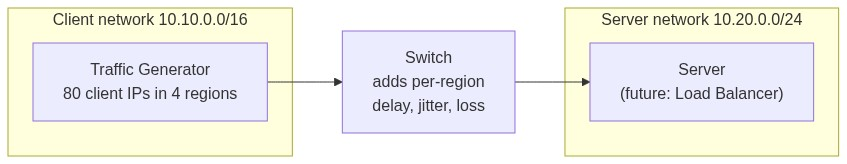
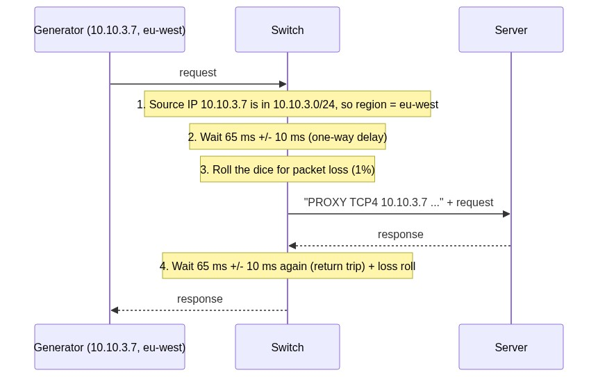
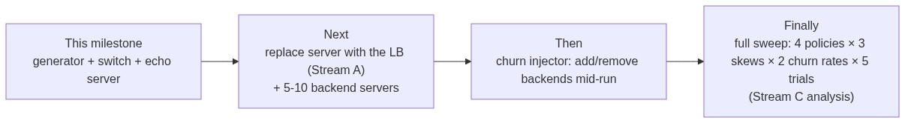

# Milestone Explainer: Multi-Region Traffic Generator & Network Switch

**CS G525 Advanced Computer Networks · Track C / C5: L4 Load Balancer · Team 9**
**Stream B (Workload & Stress Harness):** Nahush Kashyap M A
**Teammates:** Adithya Pai (Stream A, Data Plane) · Saravanasudharsan S (Stream C, Measurement & Reporting)

> This document explains what this milestone builds, why each part exists, and how it fits into the overall project. It is written for teammates and for the course instructor. Technical details for implementers are in [`milestone_plan.md`](milestone_plan.md); the longer-term design is in [`full_design_plan.md`](full_design_plan.md).

---

## 1. The project in one paragraph

We are building a **Layer-4 load balancer from scratch in Go** and using it to compare four routing algorithms (**Round Robin, basic hashing, least-loaded, consistent hashing**) under two difficult conditions: **skewed traffic**, where a few keys are extremely popular (Zipf distribution), and **connection churn**, where backend servers are added or removed while traffic is live. We measure **tail latency (p50/p95/p99)**, **load imbalance (Jain's Fairness Index)** and **connection resets per churn event**. The result is a quantitative comparison, not a running service.

## 2. What this milestone delivers

A load balancer can only be evaluated against **controlled, reproducible traffic**. This milestone builds the environment that produces that traffic:

| Component             | What it does                                                                                                                                                                                     |
|-----------------------|--------------------------------------------------------------------------------------------------------------------------------------------------------------------------------------------------|
| **Traffic generator** | Sends TCP, UDP and HTTP requests. Each request has a **key** (from a Zipf distribution) and a **real source IP** belonging to a **geographic region**                                            |
| **Switch**            | Sits between clients and the server. Identifies each request's region from its source IP and adds that region's **latency, jitter and packet loss**, imitating distant clients                   |
| **Server**            | A simple echo server that **stands in for the load balancer**. It confirms that requests arrive with the correct client IP and region. In the next milestones the real load balancer replaces it |
Everything runs **on one laptop as 3 Docker containers**.

---

## 3. The setup at a glance



- **Two separate Docker networks.** The generator is on one, the server on the other, and only the switch is on both. **All traffic therefore has to pass through the switch**, as it would through a router on a real network. We check this by confirming the generator cannot reach the server directly.
- **Regions are IP address blocks.** The generator container holds 80 IP addresses (20 per region):

| Region                     | IP block     | One-way delay | Jitter | Loss | Resulting round trip |
|----------------------------|--------------|---------------|--------|------|----------------------|
| ap-south (local, "Mumbai") | 10.10.1.0/24 | 2 ms          | ±1 ms  | 0%   | ~4 ms                |
| ap-southeast ("Singapore") | 10.10.2.0/24 | 30 ms         | ±5 ms  | 0.5% | ~60 ms               |
| eu-west ("Ireland")        | 10.10.3.0/24 | 65 ms         | ±10 ms | 1%   | ~130 ms              |
| us-east ("Virginia")       | 10.10.4.0/24 | 110 ms        | ±15 ms | 2%   | ~220 ms              |
These numbers are illustrative values based on typical India-to-region round-trip times. They are all set in one config file (`config.yaml`).

---

## 4. Component 1: Traffic Generator

### 4.1 What a request looks like
Each request has four properties:
1. **Region**, e.g. `eu-west`
2. **Key**: the item being requested, e.g. key `17` (think "video #17" or "user #17")
3. **Client IP**: a real source address from that region's block, e.g. `10.10.3.7`
4. **Protocol**: TCP, UDP or HTTP, chosen by weights (default 50% / 30% / 20%)

### 4.2 Skewed keys: the Zipf distribution
Real traffic is not uniform: a few items (popular videos, celebrity accounts) get most of the requests. A **Zipf distribution** models this. The key with popularity rank *k* is requested with probability proportional to **1/k^α**:

| α (skew) | Share of hottest key (1000 keys) | Meaning                                                  |
|----------|----------------------------------|----------------------------------------------------------|
| 0.8      | ≈ 6.5%                           | mild skew                                                |
| 1.0      | ≈ 13%                            | moderate skew                                            |
| 1.2      | ≈ 23%                            | heavy skew: one key gets almost a quarter of all traffic |
The proposal sweeps α ∈ {0.8, 1.0, 1.2}. We wrote our own sampler because Go's built-in Zipf generator only supports α > 1.

### 4.3 Making the skew visible to an L4 load balancer ("by_key")
A **Layer-4** load balancer cannot read the request contents. It only sees IP addresses and ports. So for Zipf skew to matter to it, **popular keys must show up as popular source IPs**. We do this by mapping each key to a fixed client IP:

```
client_ip = region_ips[ hash(key) mod 20 ]
```

Key 1 (the hottest) always comes from the same client IP, so that IP sends ~13% of the traffic. A hash-based load balancer will send all of it to one backend, which is exactly the imbalance the project is meant to measure.

### 4.4 Real source IPs
The generator adds 80 IP addresses to its own network interface (with the Linux `ip addr add` command) and **binds each connection to the chosen address**. The switch and server therefore see genuinely different client IPs, not one IP with a label attached.

### 4.5 When requests are sent: Poisson arrivals
Requests are not sent at perfectly regular intervals. Gaps between requests are random (**Poisson process**, the standard model for independent users) at a configured average rate (default 50 requests/s per region).

The generator is **open-loop**: it sends each request at its scheduled time **whether or not earlier requests have finished**, and measures latency **from the scheduled time**. This matters for tail latency. A generator that waits for slow responses before sending the next request would quietly hide the system's worst delays.

### 4.6 Protocols
| Protocol     | Behaviour                                  | Why it matters                                                                    |
|--------------|--------------------------------------------|-----------------------------------------------------------------------------------|
| **TCP**      | New connection per request                 | Each request is a new connection to route, which is what L4 load balancers handle |
| **UDP**      | Single datagram request/response           | Connectionless; losses are real and visible as timeouts                           |
| **HTTP/1.1** | `GET /key/<key>` over a new TCP connection | Realistic application traffic                                                     |
### 4.7 Output
Each request becomes one row in `results/gen.csv`:
```
ts_unix_ms, region, client_ip, proto, req_id, key, latency_ms, outcome, seen_ip
```
When the run ends, the generator prints a summary table (requests sent, successes, losses, p50/p95/p99 latency per region and protocol, and the most popular keys).

---

## 5. Component 2: The Switch (region simulator)

### 5.1 Why a switch?
In reality, a user in Virginia is ~110 ms from a Mumbai datacenter and their packets are more likely to be lost. On a laptop, every container is microseconds apart. The switch puts that distance back, so we can later test how each load-balancing algorithm behaves when clients are spread around the world.

### 5.2 What it does for each request


1. **Find the region** by checking which IP block the source address belongs to.
2. **Delay** the data by the region's one-way latency plus random jitter, **in both directions**, so the round trip ≈ 2 × delay.
3. **Loss:**
   - **UDP:** the datagram really is dropped with the region's loss probability. The client sees a timeout.
   - **TCP:** the switch handles TCP as a byte stream (the operating system has already handled the individual packets), so it cannot literally drop a packet. Instead it imitates what a lost packet *causes* in TCP: a **retransmission delay of 200 ms** (Linux's minimum retransmission timeout) is added with the same probability.
   - **TCP handshake:** a new TCP connection costs an extra round trip before data flows. The switch adds this on the first data of each connection, so a TCP request from a distant region costs about **2 round trips**, as it would in reality.
4. **Keep the client's identity.** Because the switch relays traffic, the server would normally see the *switch's* IP address. To prevent that, the switch adds one standard text line at the start of each connection (the **PROXY protocol**, used by HAProxy, Nginx and AWS load balancers):
   ```
   PROXY TCP4 10.10.3.7 10.20.0.10 51234 9000
   ```
   The server (and later the load balancer) reads this line to learn the real client IP.

---

## 6. Component 3: Server (placeholder for the load balancer)
- Listens on **TCP 9000, UDP 9001 and HTTP 8080**.
- Reads the PROXY line to get the real client IP, then replies:
  `RESP <req_id> <key> <server_id> <client_ip_it_saw>`
- Logs every request to `results/server.csv`.

Because the reply includes the IP the server saw, the generator can check end to end that **the client identity survived the trip through the switch**.

In the next milestones the **load balancer (Stream A)** takes this position, with **5–10 backend servers** behind it.

---

## 7. How to run it
```bash
docker compose up --build
```
The generator runs for 60 seconds, prints the summary and exits. Raw data is in `results/gen.csv` and `results/server.csv`. All settings (regions, delays, loss, rate, Zipf α, protocol mix) are in `config.yaml`.

### Expected results (default settings)
| Region       | UDP round trip | TCP / HTTP (incl. handshake) | UDP loss (both directions) |
|--------------|----------------|------------------------------|----------------------------|
| ap-south     | ~4 ms          | ~8 ms                        | ~0%                        |
| ap-southeast | ~60 ms         | ~120 ms                      | ~1%                        |
| eu-west      | ~130 ms        | ~260 ms                      | ~2%                        |
| us-east      | ~220 ms        | ~440 ms                      | ~4%                        |
The milestone is working if the measured results **match these expected values**: latency increases with distance, loss increases with distance, the server sees 80 distinct client IPs, and the most popular key receives ~13% of requests at α = 1.0.

---

## 8. Design decisions and justification

| Decision                             | Alternative considered                    | Why we chose this                                                                                                          |
|--------------------------------------|-------------------------------------------|----------------------------------------------------------------------------------------------------------------------------|
| Userspace Go switch                  | Linux kernel `tc netem`                   | Simpler to build, debug and explain; one language across the project. Limitation: TCP loss is emulated as a delay (see §9) |
| 3 containers                         | One container per region                  | Minimal setup on one laptop; regions are IP blocks, which is enough for distinct source IPs                                |
| PROXY protocol v1                    | Transparent proxying (kernel IP spoofing) | Industry standard, a single text line, no special kernel or network configuration                                          |
| `by_key` key→IP mapping              | Random client IP per request              | Makes Zipf skew visible to an L4 (IP/port-based) load balancer                                                             |
| Open-loop Poisson arrivals           | Closed-loop "send after reply"            | Doesn't hide tail latency; standard traffic model                                                                          |
| Own Zipf sampler                     | Go's `rand.Zipf`                          | Go's version can't produce α ≤ 1, which the proposal requires                                                              |
| Go only (no Python in the data path) | Python scripts                            | Proposal requirement: garbage-collection pauses would distort tail-latency measurements                                    |
## 9. Known limitations
- **TCP loss is emulated**, not real: a lost TCP chunk becomes a 200 ms delay rather than a dropped packet, and the switch does not model further retransmission backoff or connection failure after repeated losses. UDP loss is real.
- **Delay is applied per chunk of data.** This is accurate for small request/response messages, which is what we send, but would not model bandwidth limits for large transfers.
- **Single machine:** all containers share one laptop's CPU (inside Docker Desktop's Linux VM), so the maximum request rate is limited by the hardware. This will be measured and reported.
- The region delay and loss values are **illustrative**, not measured from real networks.

## 10. How this fits the rest of the project

- **For Stream A (load balancer):** read the PROXY line on each new connection or datagram to get the real client IP, and hash on that IP.
- **For Stream C (measurement):** `gen.csv` contains client-side latency and outcome for every request. Latency is measured from the **scheduled** send time, and first-byte latency is the main metric for TCP/HTTP. The key, client IP and region columns are there for imbalance analysis.

## 11. Glossary
| Term                             | Meaning                                                                                                      |
|----------------------------------|--------------------------------------------------------------------------------------------------------------|
| **L4 load balancer**             | Routes connections using only IP addresses and ports (transport layer), without reading the request contents |
| **Zipf distribution**            | A "few items are very popular" distribution; rank-k probability ∝ 1/k^α                                      |
| **Poisson arrivals**             | Random, independent request timing at a fixed average rate                                                   |
| **Open-loop**                    | Requests are sent on schedule regardless of earlier responses                                                |
| **Jitter**                       | Random variation in delay                                                                                    |
| **RTT**                          | Round-trip time: request there plus response back                                                            |
| **p50 / p95 / p99**              | Latency that 50% / 95% / 99% of requests stay under; p99 is the "tail"                                       |
| **PROXY protocol**               | A one-line header a relay adds so the next hop knows the original client address                             |
| **Retransmission timeout (RTO)** | How long TCP waits before resending a lost packet (Linux minimum: 200 ms)                                    |
| **Jain's Fairness Index**        | (Σx)² / (n·Σx²); 1.0 means load is spread perfectly evenly                                                   |