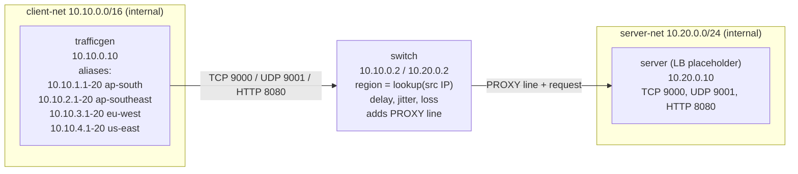

# Stream B Milestone Plan (Simplified): Traffic Generator + Region Switch

**Project:** CS G525 Track C / C5, L4 Load Balancer (Team 9) · **Stream B:** Nahush Kashyap M A
**Full long-term design:** [`full_design_plan.md`](full_design_plan.md) · **Plain-language explainer:** [`milestone_explainer.md`](milestone_explainer.md)

## Goal

The smallest working environment that shows:
1. A **Go traffic generator** sending TCP, UDP and HTTP requests. Keys come from a **Zipf** distribution, and each request uses a **real source IP** that belongs to a **region**.
2. A **Go switch** (its own container) that works out each request's region from its source IP and adds that region's **latency, jitter and packet loss**.
3. A simple **echo server** standing in for the load balancer, which shows that the real client IP and region arrive intact.

The generator prints a per-region summary at the end (sent / ok / lost / p50 / p95 / p99), so the milestone demo is `docker compose up` followed by reading one table.

## Decisions

| Decision | Choice | Why |
|---|---|---|
| Containers | **3**: `trafficgen`, `switch`, `server` | Smallest setup that still separates client, network and server. The LB later replaces `server` with no other changes |
| Regions | /24 blocks of **alias IPs** on one client network | Real distinct source IPs without one network per region |
| Key → client IP | **`by_key`**: `client = region.aliases[hash(key) % n]` | An L4 LB hashes on source IP, so hot keys must become hot IPs |
| Keeping the client IP through the switch | **PROXY protocol v1**: one text line `PROXY TCP4 <src> <dst> <sport> <dport>\r\n` | Standard (HAProxy/Nginx), human-readable, ~30 lines to parse |
| Wire format | **Plain text lines** | Can be debugged with `nc`; no binary codec needed |
| Delay | Sleep `delay ± jitter` before forwarding, in **each direction** | RTT ≈ 2 × delay; simple to reason about |
| Loss | UDP: datagram **really dropped** with prob. `loss`. TCP: chunk "lost" with prob. `loss` → +200 ms retransmission penalty | A userspace program can't drop TCP segments; the penalty models a retransmission timeout |
| Arrivals | **Poisson** at `rate_per_region`, open-loop | Standard traffic model; latency is measured from the scheduled time |
| Dependencies | Go standard library + `gopkg.in/yaml.v3` | Minimal |

**Cut from the full design (later milestones):** persistent-TCP pools, Gilbert-Elliott burst loss, admin API / live reconfiguration, PROXY v2, bandwidth caps, rate-ceiling benchmark, metadata files.

## Architecture



Both networks are `internal: true`, and the generator is attached only to `client-net`, so **it can reach the server only through the switch**.

## Configuration: `config.yaml` (one file, shared by all 3 containers)

```yaml
server:
  id: server-1
  tcp_port: 9000
  udp_port: 9001
  http_port: 8080

switch:
  client_ip: 10.10.0.2        # address the generator sends to
  server_ip: 10.20.0.10       # where the switch forwards (same ports)
  tcp_loss_penalty: 200ms     # emulated retransmission timeout

regions:                      # delay = one-way, applied in each direction
  - { name: ap-south,     cidr: 10.10.1.0/24, clients: 20, delay: 2ms,   jitter: 1ms,  loss: 0.0   }
  - { name: ap-southeast, cidr: 10.10.2.0/24, clients: 20, delay: 30ms,  jitter: 5ms,  loss: 0.005 }
  - { name: eu-west,      cidr: 10.10.3.0/24, clients: 20, delay: 65ms,  jitter: 10ms, loss: 0.01  }
  - { name: us-east,      cidr: 10.10.4.0/24, clients: 20, delay: 110ms, jitter: 15ms, loss: 0.02  }

traffic:
  duration: 60s
  rate_per_region: 50         # requests/second per region (Poisson)
  keys: 1000
  zipf_alpha: 1.0             # proposal sweep: 0.8 / 1.0 / 1.2
  mix: { tcp: 0.5, udp: 0.3, http: 0.2 }
  timeout: 2s
  seed: 42
  output: /results/gen.csv
```

## Wire protocol (text)

| Hop | Format |
|---|---|
| gen → switch (TCP, UDP) | `REQ <req_id> <key> <region> <send_unix_ns>\n` |
| gen → switch (HTTP) | `GET /key/<key>?req=<req_id>&region=<region>` (new connection per request) |
| switch → server | `PROXY TCP4 <client_ip> <server_ip> <client_port> <dst_port>\r\n` + original bytes. UDP uses `PROXY UDP4 …` (our extension; v1 itself is TCP-only) at the start of each datagram |
| server → gen | `RESP <req_id> <key> <server_id> <seen_client_ip>\n` (HTTP: same text as the body) |

Because `seen_client_ip` comes back in every response, the generator can confirm that the server saw the right client.

## Files

```
AcnProject/
├── go.mod                        # module acnlb, go 1.22, dep: gopkg.in/yaml.v3
├── config.yaml
├── Dockerfile                    # multi-stage; one image with all 3 binaries
├── docker-compose.yml
├── README.md
├── cmd/
│   ├── trafficgen/main.go        # aliases, Poisson loop per region, 3 protocols, CSV, summary
│   ├── switch/main.go            # TCP relay ×2 ports, UDP relay, region lookup, impairment
│   └── server/main.go            # PROXY-aware echo for TCP / UDP / HTTP, CSV log
├── internal/
│   ├── config/config.go          # YAML load + validate + region lookup by IP
│   ├── zipf/zipf.go (+_test)     # CDF sampler, works for any alpha > 0
│   └── proxyline/proxyline.go (+_test)  # build/parse PROXY v1 line; net.Listener wrapper
├── docs/
└── results/                      # gen.csv, server.csv (gitignored)
```

## Component details

### `internal/zipf`
```go
type Zipf struct{ cdf []float64 }
func New(n int, alpha float64) *Zipf {          // P(k) ∝ 1/k^alpha, k = 1..n
    cdf, sum := make([]float64, n), 0.0
    for k := 1; k <= n; k++ { sum += math.Pow(float64(k), -alpha); cdf[k-1] = sum }
    for i := range cdf { cdf[i] /= sum }
    return &Zipf{cdf}
}
func (z *Zipf) Sample(r *rand.Rand) int {        // returns key 1..n (1 = hottest)
    i, _ := slices.BinarySearch(z.cdf, r.Float64())
    return min(i, len(z.cdf)-1) + 1
}
```
Go's `rand.Zipf` is not used because it requires s > 1, and the proposal needs α = 0.8 and 1.0.

### `internal/proxyline`
- `Format(proto string, src, dst netip.AddrPort) string`
- `Parse(line string) (proto string, src, dst netip.AddrPort, err error)`
- `Listener` wraps a `net.Listener`: `Accept()` reads the first line and returns a conn whose `RemoteAddr()` is the real client. `server` uses it for both TCP 9000 and `http.Serve` on 8080.

### `cmd/switch`
- **TCP (9000 and 8080):** accept → region = `config.Lookup(srcIP)` (unknown → close) → dial server on the same port → write the PROXY line → two copy goroutines. For each chunk read: `sleep(delay ± jitter)`, plus `tcp_loss_penalty` if `rand < loss`; for the **first client→server chunk**, an extra `2×delay` to account for the TCP handshake RTT; then write.
- **UDP (9001):** `map[clientAddr]*session`, where each session has its own UDP socket to the server and a reader goroutine. Each datagram in each direction: drop if `rand < loss`, otherwise `time.AfterFunc(delay ± jitter, send)`. Sessions idle for over 30 s are removed.
- Logs per-region counters (conns, datagrams, drops) every 5 s.

### `cmd/server`
- TCP 9000 / UDP 9001: read the PROXY line, then the `REQ` line → reply `RESP`.
- HTTP 8080: `/key/{key}` handler; client IP from `RemoteAddr()` (set from the PROXY line).
- Appends `ts_unix_ms,proto,src_ip,region,key,req_id` to `/results/server.csv`.

### `cmd/trafficgen`
1. For each region, add `clients` alias IPs: `ip addr add 10.10.R.i/16 dev eth0` (needs `NET_ADMIN`; "File exists" is ignored).
2. Start one goroutine per region: Poisson loop (`sleep(rand.ExpFloat64()/rate)`) until `duration`.
3. For each request: `key = zipf.Sample()`, `client = aliases[fnv(key) % n]`, `proto` picked by the `mix` weights. Then `go send(...)`, with no waiting (open-loop).
4. `send` binds `net.Dialer{LocalAddr: client}` (UDP: `ListenUDP(client:0)`), sends, waits up to `timeout`, and records `latency = done − scheduled`.
5. CSV columns: `ts_unix_ms,region,client_ip,proto,req_id,key,latency_ms,outcome,seen_ip` (`outcome`: `ok` / `timeout` / `error`).
6. At the end, print a per-region and per-protocol table (sent, ok, timeout %, p50/p95/p99 ms) and the top-5 key shares.

## Expected results (60 s, default config)

| Region | UDP RTT ≈ 2×delay | TCP/HTTP ≈ 4×delay (incl. handshake) | UDP loss ≈ 1−(1−p)² |
|---|---|---|---|
| ap-south | ~4 ms | ~8 ms | 0% |
| ap-southeast | ~60 ms | ~120 ms | ~1% |
| eu-west | ~130 ms | ~260 ms | ~2% |
| us-east | ~220 ms | ~440 ms | ~4% |

Zipf check (N = 1000, α = 1.0): the hottest key ≈ 13% of requests, and the top 10 ≈ 39%.

## Verification Plan

**Automated**
```bash
go vet ./... && go test ./...      # zipf frequencies within ±2% (rel.) for α 0.8/1.0/1.2; proxyline round-trip
docker compose up --build --abort-on-container-exit   # gen exits after 60 s and prints the summary
```
**Manual**
- The summary shows latency increasing ap-south → us-east, roughly matching the table above.
- `results/server.csv`: 20 distinct `src_ip` per region, each within the right /24 (`cut -d, -f3 results/server.csv | sort -u | wc -l` → 80).
- `seen_ip == client_ip` for every `ok` row in `gen.csv`.
- Isolation: `docker compose exec trafficgen nc -zv -w2 10.20.0.10 9000` **fails** (no path that bypasses the switch).

## Agent Task Breakdown

| # | Task | Depends | Done when |
|---|---|---|---|
| T1 | `go.mod`, `config.yaml`, `internal/config` (load, validate, `Lookup(ip) *Region`) | — | Config loads; unit test for Lookup |
| T2 | `internal/zipf` + `internal/proxyline` with tests | T1 | `go test ./...` passes |
| T3 | `cmd/server` | T2 | `nc` with a hand-typed PROXY line + REQ gets a RESP |
| T4 | `cmd/switch` | T1, T2 | Local test: server + switch on loopback add the expected delay |
| T5 | `cmd/trafficgen` | T1, T2 | Runs against local switch/server and prints the summary |
| T6 | `Dockerfile`, `docker-compose.yml`, `README.md` | T3–T5 | `docker compose up --build` produces the expected table |

Conventions: `gofmt`/`go vet` clean, `context` for shutdown, `log/slog`, no global mutable state, each `main.go` under ~300 lines.
